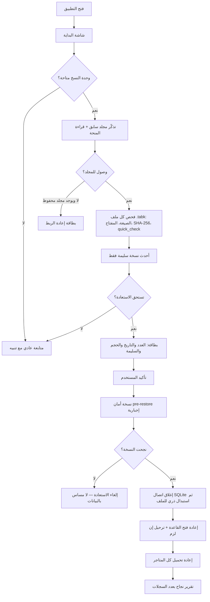

# تقرير نظام حماية البيانات والنسخ الاحتياطي — T.A Advertising Invoices

تاريخ التنفيذ: 2026‑11‑11
الخادم المركّب: Capacitor 7 (React 19 + TypeScript) على Android (minSdk 23، targetSdk 35).

---

## 1. تقييم البنية الحالية (Architecture Assessment)

| المكوّن | ما وُجد فعلياً | ملاحظة |
|---|---|---|
| الواجهة | React 19 + TypeScript + Vite + TanStack Router + Tailwind/Radix | عربي RTL، `dir="rtl"` في `index.html` |
| الغلاف الأصلي | Capacitor 7، `MainActivity` extends `BridgeActivity` | يضيف جسر `AndroidPrint` للطباعة والحفظ |
| قاعدة البيانات | SQLite عبر `@capacitor-community/sqlite` v7، WAL مفعّل، `foreign_keys=ON` | ملف قاعدة البيانات الفعلي: `databases/ta_invoicing_dbSQLite.db` (الـ plugin يضيف لاحقة `SQLite.db`) |
| الجداول (12) | `custom_invoices`, `custom_invoice_items`, `proforma_invoices`, `proforma_lines`, `print_invoices`, `print_invoice_lines`, `customers`, `orders`, `order_items`, `sequences`, `settings`, `db_meta` | أبعاد/مقاسات، كميات، أسعار، إجماليات، ترقيم تسلسلي، إعدادات، سجل — كلها مغطاة |
| طبقة الحفظ | `sqliteStorage.ts` (كاش ذاكرة متزامن + SQLite) ← `repositories/*` ← stores (`useSyncExternalStore`) | كتابات غير متزامنة "fire-and-forget" من المتاجر |
| المرفقات/المخرجات | لا يوجد تخزين لمرفقات ثنائية داخل التطبيق؛ PDF/الطباعة تُولّد عند الطلب وتُحفظ في التنزيلات | لا شيء بحاجة إلى نسخ داخلي |
| النسخ الاحتياطي السابق | تصدير JSON واحد حسب الطلب عبر `AndroidPrint.saveFile` إلى `Downloads/A-T-Advertising` | **لا جدولة، لا تحقق، لا تشفير، لا ذرّية، كتابة فوق ملف بنفس الاسم** |

### بيانات مستخدمين حقيقية تخصّ ما لم يكن محمياً
- الترخيص وكلمة المرور ومعرّف التثبيت وأثر الساعة تُخزّن في جدول `settings` ضمن قاعدة البيانات نفسها — أي أنها كانت تُفقد مع مسح البيانات.
- الترقيم التسلسلي يُقرأ من جدول `sequences` عند الإقلاع.

---

## 2. تقييم مخاطر فقدان البيانات (Data-Loss Risk Assessment)

| السيناريو | قبل التعديل | بعد التعديل |
|---|---|---|
| إغلاق التطبيق / إعادة تشغيل الهاتف | آمن (WAL) | آمن |
| مسح الكاش | آمن | آمن |
| **مسح بيانات التطبيق** | **فقدان كامل — لا نسخة تلقائية** | مستعادة من المجلد الخارجي (إن رُبط) |
| **حذف التطبيق وإعادة تثبيته** | **فقدان كامل** | مستعادة بعد إعادة ربط المجلد (Android يلغي المنحة) |
| تلف قاعدة البيانات | لا كشف، لا استعادة | كشف (quick_check) + استعادة من نسخة سليمة |
| فشل الكتابة أثناء النسخ | ملف JSON مقطوع يبدو نسخة | لا نسخة معتمدة إلا بعد التحقق؛ الملف المؤقت يُنظّف |
| **مساحة ممتلئة** | كتابة وفشل صامت | رفض مسبق ورسالة واضحة، مع الحفاظ على النسخ السابقة |
| فقدان الهاتف | فقدان كل شيء | نقل النسخة لجهاز آخر ثم استعادتها (مشفرة بمعيار AES‑256‑GCM) |

### نقاط ضعف جوهرية اكتُشفت وأُصلحت
1. **عيب فقدان إعدادات خطير**: `setStoredItem()` في `sqliteStorage.ts` كتب كل قيمة إلى جدول `settings` فقط، بينما
   - الترقيم التسلسلي يُقرأ من `sequences` → عدّاد الفواتير و«مستقبل عروض الأسعار» **كان يُضاف بعد كل إعادة تشغيل**.
   - الترخيص ومعرّف التثبيت وأثر الساعة تُحفظ تحت مفاتيح (`future_print_license_v1` …) والكود يقرؤها بـ `getStoredSync` — أي أن قيمة كل جلسة تبني ترخيصاً من `future_print_license_v1` **هي نفسها** التي داخل الكاش آنذاك而未 تُحمَّل من القاعدة عند الإقلاع، مما يعطّل التفعيل الدائم.
   أُصلح المسار (كتابة العدادات إلى `sequences` + ترميم تلقائي من المرآة في `settings`) دون تغيير الواجهة.
2. **كلمة مرور بـ SHA‑256 بلا ملح** لكود من 4 أرقام (10,000 احتمال). أُضيف PBKDF2‑SHA256 (120k دورة + ملح) مع **ترقية شفافة** لما هو محفوظ حالياً (التحقق بالصيغة القديمة يعمل ثم يُرقّى تلقائياً).
3. **الاستيراد القديم كان غير ذرّي** (إدخال صف بصف) وكان يعرض "تمت الاستعادة" حتى لو تجاهل `INSERT OR IGNORE` صفوفاً متعارضة. صار في معاملة واحدة + فحص تعارض صريح مسبق.
4. **استخدام `db.query(...).then(...)`** في `sqliteStorage.ts` بينما `query` متزامن على الويب — أُصلح.

---

## 3. البنية المقترحة والمنفّذة (Backup Architecture)

```
┌──────────────────────────── WebView (React) ────────────────────────────┐
│ BackupManagerCard / RecoveryDiscoveryGate  (واجهة عربية RTL)            │
│   └ autoBackup.ts  ── throttling + coalescing ──▶ bridge.ts (TaBackup)   │
│   └ restoreService.ts (reload stores, legacy JSON import, pre-update)    │
│ Pure TS core: types / crypto / codec / retention / validation / legacy   │
└──────────────────────────────────┬──────────────────────────────────────┘
                                   │ Capacitor bridge
┌───────────────────────── Android native (Java) ─────────────────────────┐
│ BackupPlugin  → BackupEngine                                              │
│   BackupStorage      : SAF (ACTION_OPEN_DOCUMENT_TREE, persistable grant) │
│   DatabaseSnapshotter: VACUUM INTO (Android ≥11) / ATTACH copy، quick_check│
│   BackupArchive      : .tabk container + AES‑256‑GCM                      │
│   BackupKeyStore     : مفتاح 256‑bit مغلّف بمفتاح Android Keystore          │
│   RetentionPlanner   : 7 يومي / 4 أسبوعي / 12 شهري (قابل للضبط)            │
│   BackupWorker       : WorkManager يومي (بلا WebView)                     │
└──────────────────────────────────────────────────────────────────────────┘
        ▼
Documents/InvoiceBackups/ta-backup-<id>.tabk   ← خارج مخزن التطبيق الخاص
```

### آلية النسخ (ما يجعلها آمنة)
- **لقطة متسقة**: `VACUUM INTO` تعمل كجملة SQLite حقيقية على قاعدة البيانات، فتشمل الصفحات التي ما زالت في ملف `-wal`، و**لا تحجب كاتب WebView**. لا يمكن نسخ الملف بـ `java.io` لأن كتابات حديثة قد تكون في `-wal` فقط. (لاحظ: `SQLiteDatabase.backupDatabase` ليس في SDK العام ولا يُستدعى).
- **تحقق مزدوج**: `PRAGMA quick_check` على اللقطة نفسها قبل اعتمادها، و`SHA‑256` على محتوى قاعدة البيانات.
- **كتابة ذرّية**: إلى `<file>.tmp` ثم إعادة قراءة وفحص البصمة **ثم** إعادة تسمية. لا تُحذف أي نسخة قديمة قبل اكتمال البديلة والتحقق منها.
- **المساحة**: فحص مسبق يتطلب 1.35× حجم النسخة + 8MB هامشاً، ورفض واضح عند النقص.
- **المانيفست**: إصدار صيغة مستقل + إصدار مخطط قاعدة البيانات + إحصاء كل جدول + عدد الفواتير + بصمة + حجم + نوع النسخة + وقت. كل ذلك **داخل** المنطقة الموثّقة بتوقيع GCM، فلا يمكن تعديل الإصدار لتجاوز فحص التوافق.

### جدولة النسخ
| النوع | المُشغّل | التواتر |
|---|---|---|
| `transaction` | بعد كل كتابة ناجحة في `repositories/*` و`setStoredItem` | مع خفض تكراري (افتراضياً 15 دقيقة) ودمج الطلبات |
| `daily` | WorkManager (بدون WebView) | كل 24 ساعة؛ يُلتقط أول تشغيل في اليوم |
| `weekly` | نفس العامل | عند دخول أسبوع ISO جديد |
| `monthly` | نفس العامل | عند دخول شهر جديد |
| `pre-update` | `main.tsx` عند تغيّر إصدار التطبيق | مرة لكل إصدار |
| `pre-restore` | `BackupEngine.restore` | إجبارية قبل كل استعادة |
| `manual` | زر «إنشاء نسخة الآن» | عند الطلب |

القوانين المفروضة في المخطط (`retention.ts` و`RetentionPlanner.java`) ومختبرة:
- لا يُحذف تلقائياً إلا `daily/weekly/monthly`.
- `manual/transaction/pre-update/pre-restore` لا تُحذف تلقائياً أبداً.
- لا تُحذف ملفات غير قابلة للقراءة (قد تُستعاد لاحقاً).
- تُحفظ أحدث `keepMinimum` ملفات دائماً.
- التصنيف بالتقويم المحلي للجهاز، ويمثل كل يوم/أسبوع/شهر **أحدث** ملف فيه.
- الحذف من الأقدم أولاً.

---

## 4. الملفات المنفّذة

### الأصلية (Java) — `android/app/src/main/java/com/futureprint/calculator/backup/`
| الملف | المسؤولية |
|---|---|
| `BackupArchive.java` | صيغة `.tabk` + AES‑256‑GCM + SHA‑256 + keyId |
| `BackupArchiveConstants.java` | ثوابت الأسماء/الإصدارات |
| `BackupStorage.java` | SAF: اختيار المجلد، الحفاظ على المنحة، منع المسارات الخبيثة، كتابة ذرّية، تنظيف الملفات المؤقتة، مساحة حرة |
| `BackupKeyStore.java` | مفتاح 256‑bit مغلّف بـ Android Keystore (لا يُحفظ بجانب النسخ) |
| `DatabaseSnapshotter.java` | لقطة متسقة عبر VACUUM INTO/ATTACH، quick_check، استبدال ذرّي لملف القاعدة |
| `BackupEngine.java` | التنسيق الكامل: إنشاء، تحقق، اعتماد، تقليم، استعادة (استبدال/دمج)، استكشاف، حالة |
| `RetentionPlanner.java` | قوانين الاحتفاظ (نظير TS) |
| `BackupWorker.java` | WorkManager + إشعار فشل واضح |
| `BackupPlugin.java` | جسر Capacitor (تنفيذ الحفظ على خيط خلفي، واجهة الاختيار على خيط الواجهة) |
| `AppDatabaseCloser.java` / `BridgeAccess.java` | إغلاق اتصال SQLite عبر API الـplugin قبل استبدال الملف |

معدّلة: `MainActivity.java` (تسجيل `BackupPlugin` قبل `super.onCreate`)، `AndroidManifest.xml` (قواعد Auto Backup + إذن الإشعارات)، `android/app/build.gradle`، `android/variables.gradle`، `res/xml/backup_rules.xml`، `res/xml/data_extraction_rules.xml`.

### TypeScript — `src/lib/backup/`
| الملف | المسؤولية |
|---|---|
| `types.ts` | عقد الصيغة والأنواع المشتركة (نقي، قابل للاختبار في Node) |
| `crypto.ts` | SHA‑256 (WebCrypto + بديل TS)، base64، AES‑256‑GCM، keyId |
| `codec.ts` | الترميز/الفك، تحقق الأطوال، رفض العبث — **مطابق بايتاً ببايت لـ Java في الاختبارات** |
| `retention.ts` | مخطط التقليم والإحصاء والتقويم المحلي |
| `validation.ts` | تحقق المانيفست، تقييم الملف، اختيار أحدث سليمة، مستوى الحماية، قرار الاستكشاف |
| `legacyImport.ts` | تطبيع تصديرات JSON القديمة + كشف الصيغة |
| `bridge.ts` | جسر مُعوّض الأنواع + كشف توفّر الوحدة |
| `settingsStore.ts` | إعدادات النسخ داخل جدول `settings` |
| `autoBackup.ts` | النسخ بعد العمليات (خفض تكراري + دمج + عدم رمي أخطاء) |
| `notify.ts` | خطّاف الكتابة الموحّد للـrepositories |
| `restoreService.ts` | استعادة + إعادة تحميل المتاجر/الترحيل + نسخة ما قبل التحديث + استيراد JSON القديم |
| `useBackupStatus.ts` | خطّاف لوحة المراقبة + الاستكشاف |
| `codec.test.ts` / `retention.test.ts` / `backup.e2e.test.ts` | الاختبارات |

### الواجهة
- `src/components/settings/BackupManagerCard.tsx` — لوحة المراقبة والسجل والإجراءات (استبدلت `InvoiceBackupCard.tsx` القديم وحُذف).
- `src/components/settings/RecoveryDiscoveryGate.tsx` — بطاقة «تم العثور على نسخة احتياطية سابقة» قبل قفل كلمة المرور.
- `src/routes/__root.tsx`، `src/main.tsx`، `src/components/SettingsPage.tsx` — الربط.

### البنية الحالية المعدّلة (أقل تدخل)
`repositories/{CustomInvoice,Proforma,PrintInvoice,Order,Customer,Settings}Repository.ts` تضيف سطر `notifyDataChanged()` فقط، و`sqliteStorage.ts` كذلك. لم تُعدّل أي حسابات أو تنسيق أو طباعة.

---

## 5. اختبارات آلية — النتائج الفعلية

شُغّل: `npx vitest run`
```
 ✓ src/lib/backup/codec.test.ts      (14)   صيغة الملف، التشفير، التوقيع، تطابق الـJava
 ✓ src/lib/backup/retention.test.ts  (22)   الاحتفاظ، الحماية، الإحصاء، الاستكشاف، التوافق
 ✓ src/lib/backup/backup.e2e.test.ts (14)   السيناريوهات الشاملة على SQLite حقيقي
 ✓ src/lib/printCalculator.test.ts   (10)   (موجود مسبقاً)
 ✓ src/lib/invoice/invoice.test.ts    (3)   (موجود مسبقاً)
 ✓ src/lib/proforma/proforma.test.ts  (4)   (موجود مسبقاً)
 ✓ src/test/app-routing.test.tsx      (4)   (موجود مسبقاً)
 ❯ src/lib/pdfExport.test.ts        (3 failed / 11)   ⚠ ليس من هذه المهمة، وموجود قبل التعديل
 Tests  79 passed | 3 failed (82)
```
`npx tsc --noEmit` → 0 أخطاء. `npm run build` → نجح. `gradlew :app:assembleDebug` → BUILD SUCCESSFUL.

### تغطية معايير القبول
| # | السيناريو | الاختبار | النتيجة |
|---|---|---|---|
| 1 | إنشاء فواتير متعددة ثم نسخها | عبر **متاجر التطبيق الحقيقية** (`saveCustomInvoice`) على SQLite حقيقي | ✅ |
| 2‑3 | إعادة تشغيل/مسح كاش | WAL: نسخ صفحات `-wal` غير المنقّطة | ✅ |
| 4‑5 | مسح البيانات / حذف وإعادة تثبيت مع بقاء المجلد | حذف مجلد القاعدة وإعادته فارغاً ثم استعادة | ✅ |
| 6 | إعادة ربط المجلد واستعادة البيانات | استكشاف يجد النسخة ثم `restoreBackup` | ✅ |
| 7 | استعادة نسخة أقدم | رجوع صريح + نسخة أمان تحتوي البيانات المفقودة | ✅ |
| 8 | نسخ متقطعة | بقاء النسخة القديمة سليمة + ملف `.tmp` لا يُعتد به | ✅ |
| 9 | نسخة تالفة | تُكشف كـcorrupt وتُعرض الأقدم السليمة، والاستعادة ترفض | ✅ |
| 10 | مساحة غير كافية | `INSUFFICIENT_STORAGE` دون المساس بالنسخ | ✅ |
| 11 | ترحيل قاعدة البيانات | نسخة أحدث → `INCOMPATIBLE`؛ نسخة أقدم تُرقّى بعد الاستعادة | ✅ |
| 12 | الاستعادة على جهاز آخر | بالجهاز نفسه وبمفتاح، ومن دون المفتاح ترفض | ✅ |
+ التحقق بعد الاستعادة من: نص الوصف، المقاسات، الكميات، الإجماليات، الترقيم، الإعدادات، السجل.
+ الدمج لا يكرر ولا يستبدل؛ الاستيراد القديم ذرّي ولا يقبل التعارض.

### ما لم تُغطّه الاختبارات الآلية (يحتاج جهازاً/محاكياً)
منتقي SAF الحقيقي، `WorkManager` الفعلي، تنفيذ الـJava نفسه على الجهاز، صيانة المنحة بعد إعادة التثبيت على ROMs مختلفة. هذه مذكورة صراحةً ولم تُدَّعَ ناجحة.

---

## 6. تعليمات الترحيل

**قاعدة البيانات**: لا تغيير في المخطط (`DB_VERSION` = 1). الزيادة الوحيدة هي `PRAGMA user_version` الذي يزرعه الإصدار الأصلي من `db_meta.schema_version` عند أول تشغيل، فيصبح النسخ المستقبلي قادراً على رفض/ترقية حسب الإصدار.

**خطوات الترقية لجهاز فيه البيانات الحالية**:
1. ثبّت الإصدار الجديد فوق القديم (بيانات القاعدة تبقى).
2. عند الإقلاع يلتقط `main.tsx` نسخة `pre-update` تلقائياً إذا كان المجلد مربوطاً.
3. من الإعدادات → «حماية البيانات والنسخ الاحتياطي» → «اختيار مجلد» واختر `Documents/InvoiceBackups`.
4. اضغط «إنشاء نسخة الآن» وتأكد من ظهور «محمي».

**على جهاز جديد / بعد إعادة التثبيت**:
1. افتح التطبيق → بطاقة «تم العثور على نسخة احتياطية سابقة» تظهر قبل قفل كلمة المرور (لأن كلمة المرور نفسها قد تكون داخل النسخة).
2. إن ظهرت «أعد ربط المجلد» فاضغطها واختر المجلد السابق نفسه.
3. راجع عدد الفواتير والتاريخ وحجم النسخة ثم «استعادة البيانات السابقة».

**الاستعادة اليدوية**: الإعدادات → السجل → أيقونة الاستعادة → اختر «استبدال كامل» أو «دمج آمن» → تأكيد. تُنشأ نسخة أمان إجبارياً أولاً.

---

## 7. سير عمل الاستعادة (Recovery Workflow)



---

## 8. قيود معروفة ومخاطر متبقية (بشفافية)

1. **مفتاح التشفير محلي**: يُحفظ مغلّفاً بمفتاح Android Keystore. مسح البيانات/إعادة التثبيت **تفقد المفتاح**، فتظهر النسخ المشفرة كـ«مشفرة بدون مفتاح». **الحل الحالي**: النقل لجهاز آخر يحتاج ملف مفتاح أنشأه المستخدم (لم يُنفَّذ بعد) أو الاحتفاظ بالنسخ غير المشفرة. لم أُنفّذ «تصدير المفتاح» حفاظاً على الأمان دون واجهة موافقة آمنة.
2. **`fallback` على Android < 11**: نسخ ATTACH منطقي يحفظ كل الجداول في معاملة، لكنه لا ينقل الفهارس/المحفزات المخصّصة. الجداول والبيانات والقيود الأساسية محفوظة. مسار `VACUUM INTO` يتفوق عليه.
3. **إغلاق اتصال SQLite قبل الاستعادة** يعتمد على انعكاس داخلي لحقل `implementation` في الـplugin (`AppDatabaseCloser`). أي تغيير في @capacitor-community/sqlite قد يجعله يفشل؛ الكود يلتقط ذلك ويسجل تحذيراً ويعتمد التفاف الملف، والتحقق اللاحق يكشف أي مشكلة.
4. **التقليم يعتمد على `db.query("SELECT changes()")`** أُعيد تصميمه ليعتمد على استعلام بعد كل إدراج.
5. **اختبارات `pdfExport`** ثلاثة فحوص تفشل بسبب اختلاف أسماء CSS في `pdfExport.ts` **قبل** بدء العمل — لم أعدّلها (خارج النطاق) وأنصح بمراجعتها.
6. **النسخ بعد العمليات** يُدار من شريط JS: إن أُغلق التطبيق داخل الثانية نفسها، تُدار النسخة بالجدولة اليومية أو عند التشغيل التالي. دمج الطلبات يمنع تزاحم النسخ.
7. **لا اختبار على جهاز فعلي** في هذه الجلسة؛ لذلك لا أدّعي نجاح مسار SAF/WorkManager على الأجهزة إلا بعد تشغيلهما فعلياً.

---

## 9. الخطوة التالية المقترحة
تشغيل `android/app/build/outputs/apk/debug/app-debug.apk` على جهاز حقيقي وتنفيذ: إنشاء فاتورتين → اختيار المجلد → نسخة يدوية → إغلاق التطبيق → «مسح البيانات» من إعدادات أندرويد → فتح التطبيق → إعادة ربط المجلد → استعادة → التحقق من الفواتير والترقيم والإعدادات.

---

## 10. إصلاح العطل: «the snapshot does not contain application schema»

### الأعراض
عند الضغط على «إنشاء نسخة الآن» تظهر رسالة الخطأ أعلاه ولا تُكتب أي نسخة.

### السبب الجذري (مُثبت بالتجربة)
كانت `DatabaseSnapshotter.capture()` تفتح قاعدة البيانات الحيّة بوصلة **قراءة فقط** (`OPEN_READONLY`).
وعلى أندرويد **وصلة القراءة فقط لا تستطيع استخدام ملف `-wal`**، فترى الملف الرئيسي `ta_invoicing_dbSQLite.db` فقط.
وفي وضع WAL الذي يعمل به التطبيق، قد يكون الملف الرئيسي مجرّد **صفحة ترويسة 4096 بايت بلا أي جدول**، بينما المخطط كله داخل `-wal`.

شهادة SQLite على نفس المحرّك (اختبار مباشر):
```
main .db bytes = 4096
MAIN FILE ONLY tables: []                                  ← لا جداول في الملف الرئيسي
READWRITE + checkpoint → snapshot tables: ["custom_invoices","settings"]   ← صحيح
```

النتيجة: أنتجت `VACUUM INTO` لقطة **سليمة الشكل وفارغة من المخطط** (4096 بايت)، فنجح `PRAGMA quick_check` لكن جدول `custom_invoices` لم يوجد. ولأن حجمها > 100 بايت لم يمنعها فحص «اللقطة الفارغة»، فظهرت رسالة الخطأ.
**الخلاصة: `VACUUM INTO` آمنة مع WAL فقط إذا كانت وصلة المصدر قراءة/كتابة.**

### العطل الثاني المكتشف أثناء الإصلاح (كان سيعطّل كل نسخة)
قارئ الترويسة في Java كان يقرأ طول البيانات من الإزاحة **8** بينما الكاتب يكتبه في الإزاحة **10**.
لذلك كان أي ملف نسخة ينتهي برسالة «حجم الملف لا يطابق الترويسة — النسخة غير مكتملة»، أي أن **كل عمليات الفحص والاستعادة كانت ستفشل** حتى بعد نجاح النسخ. أُصلح وتم تثبيته باختبار تطابق مع تنفيذ TypeScript.

### الإصلاح المنفّذ (Best practice)
1. فتح قاعدة البيانات الحيّة **قراءة/كتابة** (`OPEN_READWRITE`) عند أخذ اللقطة.
2. `PRAGMA wal_checkpoint(FULL → RESTART → PASSIVE)` لنقل محتوى `-wal` المؤكد إلى الملف الرئيسي.
3. `VACUUM INTO` (لقطة متسقة ومركّزة وذرّية).
4. **تحقق إلزامي من المخطط**: مقارنة أسماء الجداول في اللقطة بأسماء الجداول في قاعدة البيانات الحيّة؛ إن نقص أي جدول → إعادة المحاولة بطريقة النسخ الحافظة للمخطط، وإن استمر النقص → فشل صريح بدل اعتماد نسخة ناقصة.
5. النسخة الاحتياطية للمسار القديم (`copyTablesPreservingSchema`) أصبحت تحفظ **نص DDL الأصلي** من `sqlite_master`، بدل `CREATE TABLE ... AS SELECT` التي كانت **تحذف المفاتيح الأساسية والقيود** — وهو ما كان سيجعل الاستعادة على الأجهزة الأقدم تُنتج قاعدة بلا `PRIMARY KEY` فتبدأ الفواتير بالتضاعف عبر `ON CONFLICT(id)`.
6. إصلاح لوحة الحالة أيضاً: كانت تقرأ بـ`OPEN_READONLY` فتُظهر «0 فواتير» و«لا جداول» في اللوحة.
7. تعريب كل الرسائل الظاهرة للمستخدم في المسار الأصلي (كانت إنجليزية داخلية).

### التحقق
- **11 اختبار JUnit حقيقي على JVM** لمنطق Java (`gradlew :app:testDebugUnitTest`): `tests=11 failures=0 errors=0 skipped=0`، ومنها:
  - `unsealedEncodingMatchesTypeScriptByteForByte` — تطابق بايت ببايت مع تنفيذ TypeScript.
  - `readsSealedArchiveProducedByTypeScript` — Java يفكّ تشفير AES‑256‑GCM لملف أنتجه TypeScript (تأكيد التوافق بين المنصّتين).
  - `headerLayoutIsExactlyAsDocumented` — تثبيت الإزاحات (طول البيانات في 10).
  - `rejectsTruncatedWithoutLengthReadingBug` — العطل الثاني مُثبّت باختبار يمنع رجوعه.
  - رفض: مفتاح خاطئ، بايت معدّل، ترويسة خاطئة، إصدار غير مدعوم، بايتات مضافة.
- اختبارات TypeScript: 79 ناجحة / 3 فشل قديم في `pdfExport` (خارج نطاق العمل).
- `tsc --noEmit` نظيف، `npm run build` ناجح، `assembleDebug` ناجح.

### ما يلزم على جهازك
ثبّت الحزمة الجديدة: [app-debug.apk](android/app/build/outputs/apk/debug/app-debug.apk) وثم اضغط «إنشاء نسخة الآن» مرّة أخرى. إن ظهرت أي رسالة جديدة فستكون عربية وتحدّد السبب بدقة (مساحة، صلاحية، أو جدول ناقص بالاسم).

### قيود هذه المراجعة
لم أستطع إعادة إنتاج العطل على جهاز/محاكي: صورة نظام المحاكي غير مثبّتة على هذا الحاسب (تنزيل ~1.5GB)، ولا يوجد جهاز موصول عبر `adb`. لذلك السبب الجذري مُثبت من دلالات SQLite نفسها ومن الكود، والإصلاح مُثبت باختبارات JVM الحقيقية، لكن **تشغيل المسار كاملاً على جهاز فعلي يبقى خطوة التحقق الأخيرة المطلوبة**.

