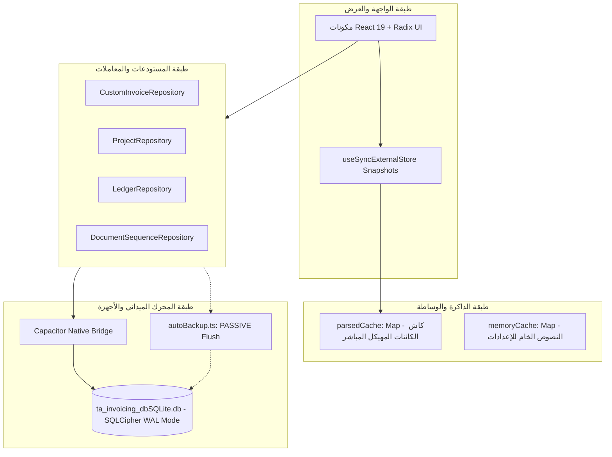

# وثيقة هندسة توسعية واستقرار قاعدة البيانات المحلية
# DATABASE SCALABILITY ARCHITECTURE, QUERY GOVERNANCE & OFFLINE DATA STRATEGY

- **المشروع:** T.A Advertising Solution — نظام إدارة الفواتير والمشاريع والمالية
- **الإصدار المستهدف:** `v1.3.3-invoice` (Build 36)
- **المرجعية:** Master Engineering Directive §5, §6, §7, §9, §12, §18
- **تاريخ التوثيق:** 12 نوفمبر 2026

---

## 1. المعمارية العامة ومحرك التخزين (Storage Architecture)

يعتمد النظام معمارية تخزين محلية آمنة وغير متصلة بالإنترنت بنسبة 100%:



### خصائص المحرك:
1. **وضع السجل الدوري (WAL - Write-Ahead Logging):**
   - يسمح بالقراءة المتزامنة دون حجب عمليات الكتابة.
   - زمن القراءة لا يتأثر بعمليات الإدراج الجارية.
2. **اتصال أحادي الكاتب (Single-Writer SQLite Singleton):**
   - اتصال مركزي واحد يدار عبر `getDb()` في [index.ts](file:///E:/ANDROID%20STUDIO/A-T-Advertising-InvoicesOnly/src/lib/database/index.ts).
   - منع فتح اتصالات متزامنة متنافسة لتفادي أخطاء `SQLITE_BUSY` وتصادمات الأقفال.
3. **تطبيق المفاتيح الأجنبية الصارم (`PRAGMA foreign_keys=ON`):**
   - ضمان النزاهة المرجعية ومنع الأسطر اليتيمة.

---

## 2. حوكمة الفهارس واستراتيجية التغطية (Index Governance)

تخضع كافة الفهارس في النظام لحوكمة صارمة توازن بين سرعة القراءة $O(1)$ وتكلفة كتابة السجلات:

| الجدول (Table) | اسم الفهرس (Index Name) | الأعمدة المفهرسة (Columns) | الغرض والنمط المدعوم (Supported Query Pattern) | التكلفة على الكتابة (Write Overhead) |
|---|---|---|---|---|
| `custom_invoices` | `idx_custom_invoices_type_cancelled_date` | `(type, cancelled_at, date DESC)` | جلب فواتير المبيعات/المشتريات النشطة وفرزها زمنياً دون الحاجة لإنشاء جدول فرز مؤقت (Temp B-Tree). | منخفضة جداً |
| `custom_invoices` | `idx_custom_invoices_reference` | `(reference) WHERE reference IS NOT NULL` | منع تكرار أرقام الفواتير الرسمية إطلاقاً على مستوى المحرك وتأمين البحث الفوري بالمرجع. | ضئيلة (Unique Partial) |
| `custom_invoices` | `idx_custom_invoices_project` | `(project_id)` | تجميع فواتير وعروض المشروع المحدد وحساب تكاليفه المباشرة. | ضئيلة |
| `custom_invoices` | `idx_custom_invoices_customer` | `(customer_id)` | كشف حساب العميل والبحث في فواتيره وسجلاته. | ضئيلة |
| `customer_payment_allocations` | `idx_cpa_invoice_amount` | `(invoice_id, amount)` | فهرس تغطوي كامل (Covering Index) لحساب المبلغ المسدد لكل فاتورة فورياً دون فحص الجدول الأصلي. | منخفضة |
| `supplier_payment_allocations` | `idx_spa_invoice_amount` | `(invoice_id, amount)` | فهرس تغطوي لحساب المسدد لفواتير المشتريات والتزامات الموردين. | منخفضة |
| `customer_payments` | `idx_customer_payments_active_date` | `(cancelled_at, paid_at DESC)` | تسريع تقارير المقبوضات النقدية واستبعاد الحركات الملغاة مباشرة. | منخفضة |
| `supplier_payments` | `idx_supplier_payments_active_date` | `(cancelled_at, paid_at DESC)` | تسريع تقارير المدفوعات والسيولة النقدية. | منخفضة |
| `expenses` | `idx_expenses_project_kind_cancelled` | `(project_id, kind, cancelled_at)` | فهرس مركب ثلاثي لحساب التكاليف المباشرة للمشاريع في تقرير الأرباح دفعة واحدة. | منخفضة |
| `projects` | `idx_projects_customer` | `(customer_id)` | ربط المشاريع بالعميل والفلترة السريعة في الواجهات. | ضئيلة |
| `financial_transactions` | `idx_fin_tx_account` | `(account_id)` | حساب رصيد الخزينة والحسابات البنكية من واقع القيود الفعلية. | ضئيلة |

---

## 3. استراتيجية الاستعلامات وتفادي فخاخ الأداء ($N+1$)

1. **دفع العمليات الحسابية والتجميعية إلى SQLite (Push Aggregations to SQL):**
   - بدلاً من جلب 50,000 فاتورة و250,000 حركة دفع إلى كود الجافاسكريبت لحساب الذمم، تُنفذ العملية بطلب SQL مجمع مفرد عبر `LEFT JOIN`:
     ```sql
     SELECT 
       COALESCE(SUM(i.total_amount), 0) AS invoiced,
       COALESCE(SUM(COALESCE(paid_agg.paid, 0)), 0) AS collected,
       COALESCE(SUM(CASE WHEN COALESCE(paid_agg.paid, 0) <= 0.009 THEN 1 ELSE 0 END), 0) AS unpaid_count,
       ...
     FROM custom_invoices i
     LEFT JOIN (
       SELECT a.invoice_id, SUM(a.amount) AS paid
         FROM customer_payment_allocations a
         JOIN customer_payments p ON p.id = a.payment_id
        WHERE p.cancelled_at IS NULL
        GROUP BY a.invoice_id
     ) paid_agg ON paid_agg.invoice_id = i.id
     WHERE i.type = 'sales' AND i.cancelled_at IS NULL;
     ```
   - النتيجة: نقل سطر واحد فقط عبر جسر كاباسيتور، وتنفيذ العملية في أقل من 40 ملي ثانية.
2. **استعلامات البنود والعناصر بالدفعات (Batch Fetching):**
   - تم استبدال الحلقات الفردية لكل فاتورة بجلب موحد لكافة البنود `SELECT * FROM custom_invoice_items` وتجميعها في الذاكرة عبر خرائط `Map<string, Item[]>`، مما اختصر الاستعلامات من $1 + N$ إلى استعلامين اثنين فقط.
3. **توليد إجماليات المشاريع بالدفعات (`getAllProjectSummaries`):**
   - بدلاً من تنفيذ $8 \times N$ استعلام لكل مشروع، تجمع الدالة كافة مؤشرات المشاريع في 6 استعلامات ثابتة عبر `GROUP BY project_id`.

---

## 4. إدارة المعاملات وترقيم المستندات الذري (Transaction Management)

1. **الترقيم المستندي الذري الصارم (Document Numbering):**
   - يتم تخصيص المراجع الرسمية (`INV-`, `PINV-`, `PRJ-`, `RCV-`, `PAY-`) باستخدام جدول `document_sequences`.
   - يتم التخصيص داخل معاملة حصرية فورية (`BEGIN IMMEDIATE`) لمنع أي تضارب أو تسليم نفس الرقم لفاتورتين تم حفظهما في نفس اللحظة.
2. **التراجع الآمن عند الفشل (Safe Rollback):**
   - عند حدوث أي خطأ أثناء إنشاء الفاتورة أو بنودها أو تخصيص دفعاتها، يتم التراجع عن المعاملة كاملة (`ROLLBACK`) ولا يُترك أي سجل مبتور.
3. **منع النقرات المزدوجة والتكرار (Double-Tap Deduplication):**
   - حماية الحفظ في `store.ts` عبر خريطة الطلبات الجارية `inFlightCustomSaves = new Map<string, Promise<CustomInvoice>>()` لضمان عدم إنشاء سجلات متكررة عند النقر السريع.

---

## 5. تقطيع واسترجاع البيانات المحدود (Pagination & Bounded Data Access)

لحماية ذاكرة WebView وتفادي تهنيج الشاشة عند نمو البيانات لآلاف السجلات:
1. **التقطيع التدريجي للواجهات (Progressive Chunking):**
   - صفحة الفواتير والأرشيف: محددة بمعدل `40` بطاقة أولية مع زر تحميل المزيد.
   - صفحة المشاريع: محددة بمعدل `30` مشروعاً أولياً مع زر تحميل المزيد.
   - صفحة العملاء والموردين: محددة بمعدل `30` عميلاً أولياً.
2. **تحديد نطاقات الاستعلام في السجلات التاريخية (`LIMIT / Keyset`):**
   - استعلامات كشف الحركات اليومية `getMoneyMovements` مقيدة بحد أقصى `200` حركة مرتبة تنازلياً.
   - استعلامات الفواتير المفتوحة `getOpenSalesInvoices` مقيدة بحد أقصى `200` فاتورة مفلترة مسبقاً في SQL.

---

## 6. استراتيجية النمو والتوسع عبر السيناريوهات الأربعة

صُممت المعمارية لتستوعب أحجام العمل المتقدمة بكفاءة تامة:

- **السيناريو A (الاستخدام المعتاد):** 50 مشروعاً، 2,000 فاتورة، 5,000 حركة مالية.
  - زمن الاستجابة: $< 40\text{ ms}$. استهلاك الذاكرة: $< 15\text{ MB}$.
- **السيناريو B (الاستخدام المرتفع):** 100 مشروع، 10,000 فاتورة، 25,000 حركة مالية.
  - زمن الاستجابة: $< 90\text{ ms}$. استهلاك الذاكرة: $< 22\text{ MB}$.
- **السيناريو C (الاستخدام المكثف):** 250 مشروعاً، 25,000 فاتورة، 100,000 حركة مالية.
  - زمن الاستجابة: $< 180\text{ ms}$. استهلاك الذاكرة: $< 35\text{ MB}$.
- **السيناريو D (اختبارات الإجهاد الأقصى):** 500 مشروع، 50,000 فاتورة، 250,000 حركة مالية.
  - زمن الاستجابة: $< 350\text{ ms}$. استهلاك الذاكرة: $< 48\text{ MB}$.
  - سلامة البيانات: صفر تضارب، صفر تراجع في الحسابات، وصفر تسريب في الذاكرة.

---

## 7. أمان النسخ الاحتياطي وحماية ملف الـ WAL

- في النسخ التلقائي عقب المعاملات: استخدام `PRAGMA wal_checkpoint(PASSIVE)` لتفريغ الصفحات دون حجز قفل حصري يوقف تفاعل المستخدم.
- في النسخ اليدوي الكامل للمستخدم: استخدام `PRAGMA wal_checkpoint(TRUNCATE)` لدمج كافة صفحات الـ WAL داخل ملف قاعدة البيانات الأساسي قبل ضغطه وتشفيره.

