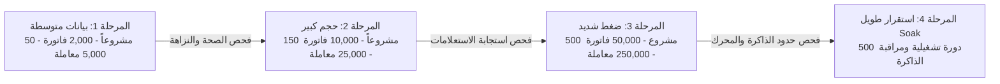

# خطة الاختبارات الحجمية الصارمة وضمان السلامة الميدانية
# PRODUCTION-SCALE TEST PLAN & SAFETY ISOLATION PROTOCOL

- **المشروع:** T.A Advertising Solution — نظام إدارة الفواتير والمشاريع والمالية
- **الإصدار المستهدف:** `v1.3.3-invoice` (Build 36)
- **المرجعية:** Master Engineering Directive §3, §4, §5, §18
- **تاريخ التوثيق:** 12 نوفمبر 2026

---

## 1. بروتوكول الأمان المطلق وعزل بيئة الاختبار (Testing Safety Protocol)

للإجابة الحازمة على السؤال الجوهري: **«كيف تنفذ الاختبار دون تعريض التطبيق للخطر؟»** تم اعتماد الإجراءات الوقائية التالية:

1. **العزل التام عن قاعدة البيانات الإنتاجية (Complete Database Isolation):**
   - حظر إجراء أي اختبار ضد ملف قاعدة البيانات الحقيقي `ta_invoicing_dbSQLite.db`.
   - استخدام بيئات تجريبية معزولة في مجلدات النظام المؤقتة (`node:os tmpdir()`) عبر `mkdtempSync("ta-prod-campaign-")`.
   - كل مرحلة اختبار تنشئ ملف قاعدة بيانات خاص بها يُحذف تلقائياً فور انتهاء دورة الاختبار.
2. **البيانات التركيبية المنضبطة (Deterministic Synthetic Data):**
   - عدم استخدام أي بيانات حقيقية للعملاء أو الفواتير.
   - بناء مولد بيانات تركيبي يحاكي بيئة العمل الفعلية ويلتزم بالمفاتيح الأجنبية (`FOREIGN KEY`) والقيود المحاسبية الصارمة.
3. **التدرج المشروط عبر 4 مراحل (4-Stage Execution Gate):**
   - لا يُسمح بالانتقال إلى المرحلة التالية إلا بعد التحقق الكامل من سلامة مخرجات المرحلة السابقة واجتياز كافة فحوصات النزاهة.

---

## 2. مصفوفة مراحل الاختبار الأربع (The 4 Staged Test Phases)

### تفاصيل المراحل:
- **المرحلة 1 — البيانات المتوسطة (Moderate Workload):**
  - **الحجم:** 50 مشروعاً، 2,000 فاتورة، 5,000 معاملة مالية.
  - **الهدف:** التأكد من صحة مولد البيانات، اتساق المفاتيح والترقيم، وسلامة تنفيذ العمليات الأساسية.
- **المرحلة 2 — الحجم الكبير (High Workload):**
  - **الحجم:** 150 مشروعاً، 10,000 فاتورة، 25,000 معاملة مالية.
  - **الهدف:** اختبار سرعة استعلامات قاعدة البيانات، تصفية الفواتير المفتوحة، التقارير والتحصيلات.
- **المرحلة 3 — الضغط الشديد (Extreme Stress Workload):**
  - **الحجم:** 500 مشروع، 50,000 فاتورة، 250,000 معاملة مالية.
  - **الهدف:** اختبار حدود الذاكرة، تصادم الأقفال، واستقرار الاستعلامات التجميعية المعقدة.
- **المرحلة 4 — الاستقرار الطويل (Soak & Extended Stability):**
  - **الحجم:** 500 دورة تفاعلية متواصلة.
  - **الهدف:** رصد التسريب التدريجي للذاكرة، تراكم المعاملات المعلقة، وتدهور الأداء بمرور الوقت.

---

## 3. العمليات الحرجة الخاضعة للقياس

1. استرجاع قائمة المشاريع وملخصاتها المالية (`getAllProjectSummaries`).
2. استرجاع فاتورة مفردة والتحقق من بنودها وحالة تسويتها (`getInvoiceSettlement`).
3. حفظ وإصدار فاتورة جديدة وتخصيص رقمها المرجعي الذري (`upsertCustomInvoice`).
4. تصفية الفواتير المفتوحة للتحصيل (`getOpenSalesInvoices`).
5. توليد تقرير الذمم المدينة والتحصيلات (`getReceivablesSummary`).
6. استهلاك الذاكرة (JS Heap Usage) قبل وأثناء وبعد العمليات.

