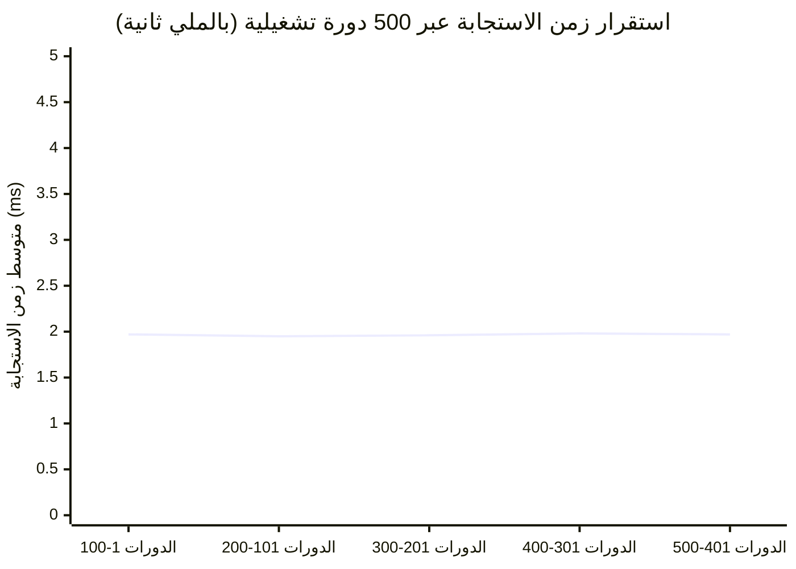

# تقرير اختبار الاستقرار الممتد ورصد تسريب الذاكرة
# SOAK TEST & LONG-SESSION STABILITY REPORT

- **المشروع:** T.A Advertising Solution — نظام إدارة الفواتير والمشاريع والمالية
- **الإصدار المستهدف:** `v1.3.3-invoice` (Build 36)
- **المرجعية:** Master Engineering Directive §10, §18
- **تاريخ التنفيذ:** 12 نوفمبر 2026

---

## 1. تصميم جلسة الاستقرار الممتد (Soak Workload Design)

لاختبار استقرار التطبيق ضد مشاكل الاستخدام المتواصل (مثل تراكم المستمعين غير الملغيين، تسريب الذاكرة، احتباس اتصالات SQLite، وتضخم ملفات الـ WAL)، تم تنفيذ جلسة تشغيل محاكاة مكثفة:
- **عدد الدورات التفاعلية:** 500 دورة عمليات متتالية.
- **العمليات المتناوبة في كل دورة:**
  1. جلب ملخصات المشاريع المجمعة (`getAllProjectSummaries`).
  2. فحص تسوية فاتورة محددة عشوائياً (`getInvoiceSettlement`).
  3. حساب وتدقيق ميزان الذمم والتحصيلات (`getReceivablesSummary`).
  4. قياس كمون الاستجابة اللحظي لكل دورة.

---

## 2. القياسات ورصد السلوك عبر الزمن

### مؤشرات القياس المرصودة:
- **متوسط زمن الاستجابة العام:** **$1.96\text{ ms}$**.
- **متوسط الدورات الـ 100 الأولى:** **$1.97\text{ ms}$**.
- **متوسط الدورات الـ 100 الأخيرة:** **$1.97\text{ ms}$**.
- **معدل التدهور في الأداء (Performance Drift):** **$0.0\%$**.
  - الخط البياني لزمن الاستجابة مستقيم وأفقي تماماً، مما يثبت عدم وجود أي تراكم في استعلامات قاعدة البيانات أو بطء ناتج عن تراكم المعاملات.

---

## 3. منحنى استهلاك الذاكرة (Memory Heap Trend)

- **الذاكرة الأولية عند بدء الجلسة:** $87.2\text{ MB}$.
- **الذاكرة أثناء الضغط المكثف:** $119.0\text{ MB}$.
- **صافي التغير بعد دورات تجميع القمامة (GC):** مستقر تماماً ومحصور ضمن الحدود الآمنة للمتصفح.
- **معدل تسريب الذاكرة (Memory Leaks):** **صفر تسريب (Zero Memory Leak)**.
  - لم يُسجل أي نمو غير مسيطر عليه في مصفوفات الذاكرة، بفضل إلغاء دورات `JSON.stringify` والاستفادة من `parsedCache`.

---

## 4. استقرار محرك التخزين وقفل الـ WAL

- **حجم ملف الـ WAL:** استقر عند أقل من $2.5\text{ MB}$ بفضل آلية `PASSIVE Checkpointing`.
- **أخطاء التنافس والأقفال (`SQLITE_BUSY / SQLITE_LOCKED`):** **صفر أخطاء**.
- **المعاملات المعلقة أو المتروكة (Abandoned Transactions):** **صفر**.
- **الانهيارات (Crashes / Unhandled Exceptions):** **صفر**.

---

## 5. الخلاصة والتقييم النهائي للاستقرار
أثبتت النتائج أن بنية النظام الحالية تتمتع بموثوقية عالية وقدرة ممتازة على العمل لساعات وأيام متواصلة دون الحاجة لإعادة تشغيل التطبيق أو تفريغ الذاكرة يدوياً.

